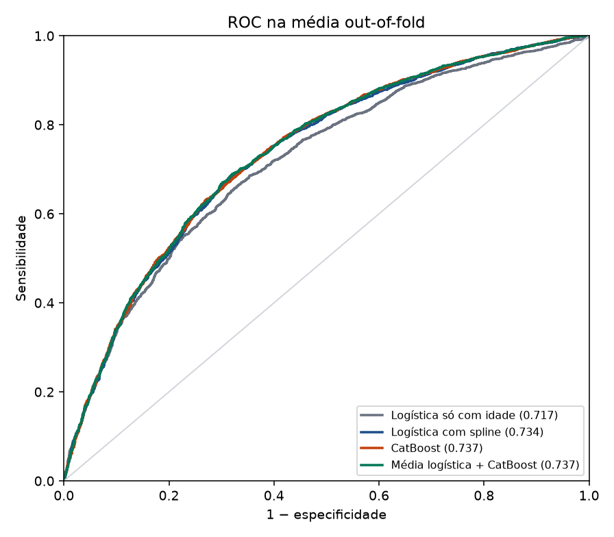
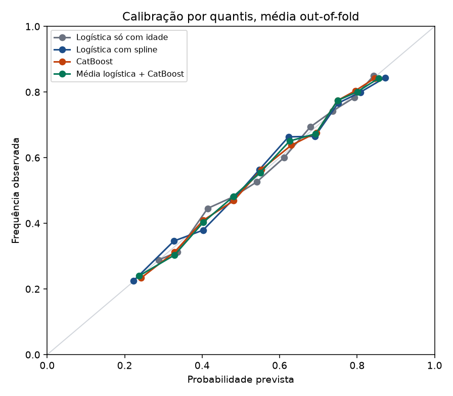
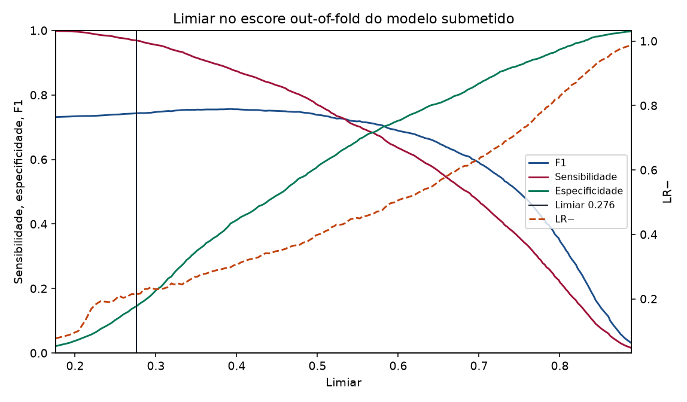

# Predição de óbito hospitalar

Modelo para o Code Challenge da [ERAMIA-RS 2026](https://eramia-rs.sbc.org.br/2026/#/challenges): a partir de dados clínicos, sociodemográficos e de comorbidades, estimar a probabilidade de óbito na internação e classificar cura (0) ou óbito (1).

O ranking oficial usa a AUC-ROC arredondada em três casas, com faixas de empate de 0,010, depois a razão de verossimilhança negativa (LR−) e, por último, o F1. A submissão é um CSV `id,prob,desfecho`, e a classe 1 só vale quando `prob` é maior ou igual a um único limiar.

## Resultado da validação

Isto não é o teste de 1.605 linhas. Esse arquivo só sai no dia da competição. O número abaixo é a AUC da média das previsões out-of-fold, numa validação cruzada estratificada repetida (5 folds × 5 repetições), com os mesmos folds para todos os modelos. Spline, categorias e o número de árvores são ajustados só no treino de cada fold.

| Modelo | AUC | IC 95% bootstrap | IC 95% DeLong | Brier | Slope |
| --- | ---: | --- | --- | ---: | ---: |
| Logística só com a idade | 0,717 | 0,705–0,729 | 0,704–0,730 | 0,211 | 1,01 |
| Logística com spline | 0,734 | 0,722–0,747 | 0,722–0,747 | 0,205 | 0,96 |
| CatBoost | 0,737 | 0,725–0,749 | 0,725–0,749 | 0,204 | 1,04 |
| Média dos dois | 0,737 | 0,725–0,750 | 0,725–0,750 | 0,204 | 1,02 |

A submissão usa a média simples da logística e do CatBoost. O limiar gravado no modelo é **0,276163**.

No mesmo escore out-of-fold em que o limiar foi escolhido (leitura otimista): sensibilidade 0,969, especificidade 0,145, **LR− 0,214**, **F1 0,743**, com 8,0% dos casos previstos como cura. Quando o limiar de cada repetição é escolhido sem olhar essa repetição, a LR− média fica em **0,221** (0,207 a 0,233) e o F1 médio em **0,744**.

Os dois intervalos da AUC concordam. O desvio entre as cinco repetições é pequeno (0,001) porque cada repetição vê os mesmos 6.332 pacientes; ele não é a incerteza do teste. O arquivo `artifacts/metrics.json` tem as contas completas.







A idade sozinha já explica a maior parte. O restante sobe a AUC em cerca de 0,020. Cabe dentro do que a literatura vê quando não há exame laboratorial, e não é um motivo para trocar de família de modelo por alguns milésimos. A nota de pesquisa discute isso com as referências.

## Como rodar

O CSV de treino não está no git. O regulamento não autoriza republicar a base. Coloque `final_treino_val.csv` em `data/`.

```bash
uv sync
uv run desfecho train --data data/final_treino_val.csv
uv run desfecho evaluate
uv run desfecho visualize --data data/final_treino_val.csv
uv run desfecho predict --data teste.csv --out submissao.csv
uv run pytest
```

`predict` só lê o modelo já gravado e o limiar que está dentro dele. Não baixa peso, não reestima limiar e não usa a coluna de desfecho se ela vier por engano. No dia, com o ambiente já instalado:

```bash
uv run --offline desfecho predict --data teste.csv --out submissao.csv
```

Os notebooks `notebooks/01_exploracao.ipynb` e `notebooks/02_modelo.ipynb` abrem no Colab. O segundo repete o treino.

O zip pedido no regulamento, com o código e a lista de linguagens e bibliotecas:

```bash
uv run desfecho package
```

## O que tem no repositório

- `src/desfecho/` — leitura, modelos, validação, limiar, CLI
- `artifacts/` — modelo, limiar, métricas e previsões out-of-fold
- `figs/` — ROC, calibração, limiar, idade, importâncias
- `docs/abordagem.md` — o raciocínio, em português
- `docs/nota-de-pesquisa.md` — literatura, links e por que cada escolha
- `docs/ferramentas.md` — o documento curto que vai no zip
- `AGENTS.md` — notas para quem for mexer no código, em inglês
- `tests/` — métricas, limiar, submissão e uma validação curta

## Limitações

A AUC de 0,737 é de validação cruzada, não do ranking. Com 1.605 casos de teste, uma simulação com AUC 0,80 já dá desvio-padrão de cerca de 0,011, maior que a faixa de empate de 0,010. Entre soluções parecidas, a LR− é que separa.

O limiar deixa passar poucos óbitos e marca a maioria como óbito. É o que a regra do desafio pede (falso negativo pesa mais), e por isso a especificidade fica baixa de propósito. Não é um ponto de corte para uso clínico fora da competição.

A fonte dos dados não foi confirmada pela organização. A semelhança com a ficha do SIVEP-Gripe é uma hipótese, e há detalhes dela que este arquivo não confirma. Está escrito na nota.
