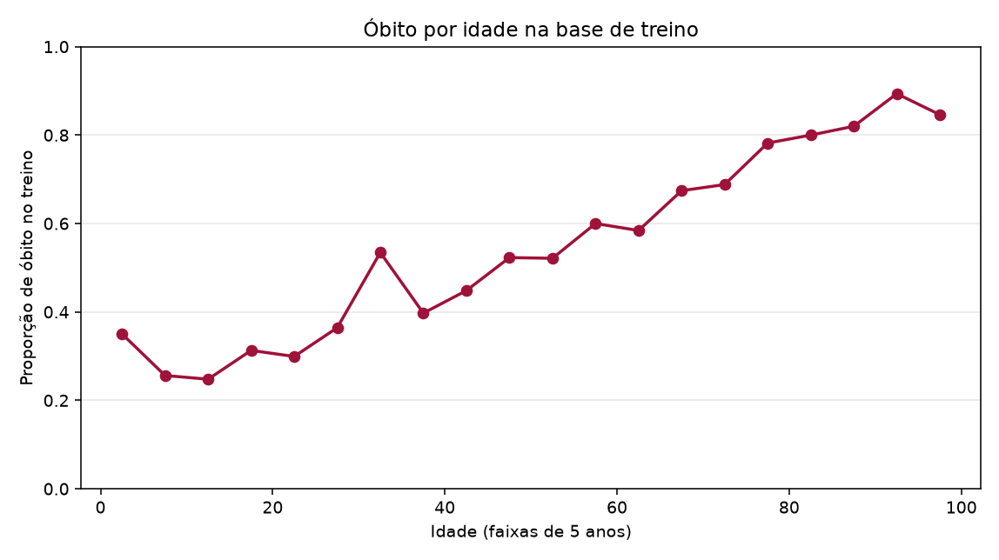
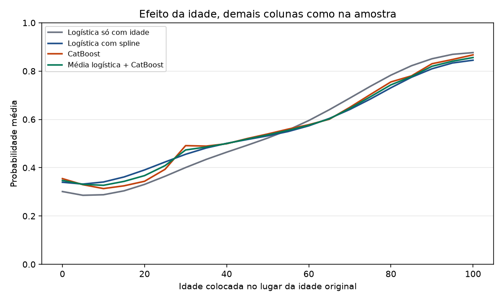
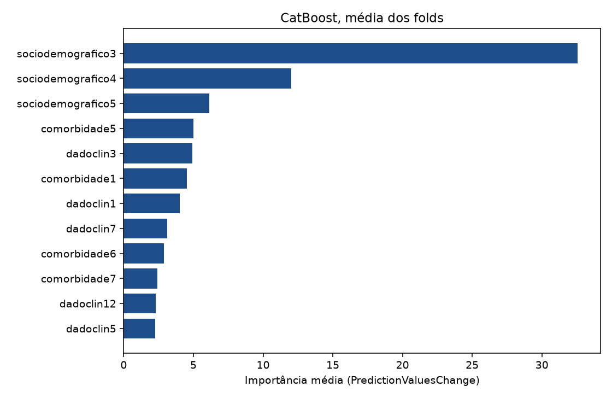
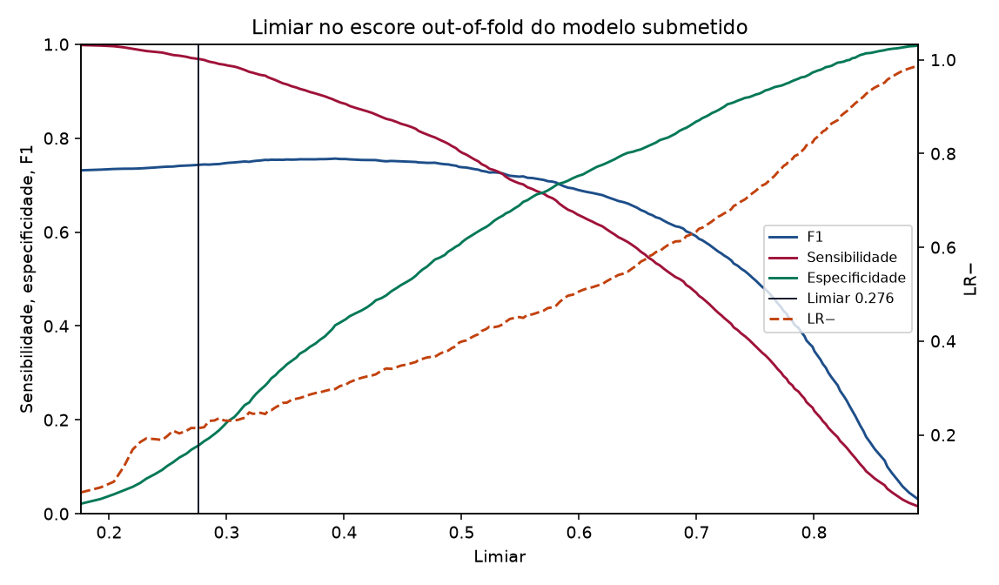

# Como o modelo foi pensado

Este texto é para quem vai ler a solução, não para quem vai editar o código. Os números vêm da validação cruzada descrita no README. A discussão com a literatura está na [nota de pesquisa](nota-de-pesquisa.md).

## O que a prova pede

Cada linha é uma internação. O alvo é `DESFECHO`: 0 cura, 1 óbito. Óbito é a classe positiva. Eu entrego, para cada `id` do teste, uma probabilidade e uma classe. A classe tem de ser reproduzível com um único corte: 1 se a probabilidade for maior ou igual ao limiar, 0 caso contrário. Submissão em que isso não fecha é desclassificada.

A ordem do ranking é hierárquica. Primeiro a AUC, arredondada em três casas, com empate se a diferença para a melhor da faixa for de até 0,010. Depois a LR−, que é `(1 − sensibilidade) / especificidade`. Menor é melhor. Se a especificidade for zero, a LR− é infinita. Por último o F1, que só desempata quem ficou com a mesma LR−.

O regulamento diz que o falso negativo é o erro mais grave. A LR− é exatamente o preço de deixar um óbito passar, dividido pela capacidade de reconhecer a cura. Baixar o limiar melhora a LR−, até o ponto em que quase ninguém é classificado como cura e a especificidade desaba.

## Por que a idade manda

Na base de treino há 6.332 linhas e 57,2% de óbitos. Não há valor ausente. As colunas binárias são de fato 0 ou 1. A idade (`sociodemografico3`) vai de 0 a 102, com cara de anos, não de dias. A mortalidade sobe com a idade: cerca de 29% abaixo dos 18 anos e cerca de 83% a partir dos 80.

Uma logística só com uma spline de idade chega a AUC 0,717. O modelo completo chega a 0,737. Ou seja, as outras 25 colunas existem e ajudam, mas não há um sinal escondido muito maior do que a idade. O identificador, convertido em número, tem AUC 0,508. Eu não uso o `ID` como feature. Se ele carregasse tempo ou hospital, a AUC dele não seria essa, e mesmo assim eu não usaria: identificador não é dado clínico, e no teste a sequência pode ser outra.

A curva empírica não é perfeitamente lisa. Há um degrau perto dos 30–35 anos. A spline e o CatBoost alisam isso. Eu não tenho o dicionário confirmado da coluna, então não vou inventar uma explicação clínica para o degrau.

## O que entra no modelo

Entram todas as preditoras do arquivo, sem seleção. Eu olhei a associação de cada coluna com o desfecho para entender a tabela, e em seguida deixei todas. Escolher coluna depois de ver a amostra inteira e reportar a mesma validação deixaria o número bonito demais.

- 14 colunas `dadoclin*` e 7 `comorbidade*`, mais `sociodemografico1` e `sociodemografico2`, entram como 0/1.
- A idade entra numa spline cúbica com 5 nós nos quantis. A logística linear em idade perderia a curvatura das pontas; a spline deixa o efeito saturar nos muito idosos sem eu escolher o ponto de corte.
- `sociodemografico4` tem 27 níveis (códigos 1 a 27, o 26 é o mais comum) e `sociodemografico5` tem 5. São nominais. Tratar o código como número fingiria uma ordem que ninguém confirmou. Na logística, a categoria mais frequente vira a referência e o resto vira indicador. Nível que não apareceu no treino do fold cai nessa referência, em vez de quebrar o `predict`. No CatBoost as duas entram como categóricas nativas. A de 5 níveis é one-hot (`one_hot_max_size=10`); a de 27 usa a estatística ordenada do CatBoost, que não vaza o alvo do jeito que um target encoding calculado fora do fold vazaria.

Não criei a soma das comorbidades. Na logística ela é combinação linear das sete colunas e só deixa a matriz singular.

Não usei SMOTE nem `class_weight`. A AUC não melhora com isso, e a probabilidade deixa de significar frequência. O slope de calibração do ensemble ficou em 1,02 e o intercepto em −0,005. Platt ou isotônica, aqui, seriam enfeite. Isotônica ainda cria degraus e pode piorar a AUC. O limiar foi cortado na probabilidade crua.

## Dois modelos, média simples

A logística com spline é o modelo que dá para explicar: coeficiente nas binárias, curva de idade, calibração boa. O CatBoost é o boosting que trata categórica sem eu inventar encoding. Os dois ficaram a 0,003 de AUC. O teste de DeLong pareado não separa CatBoost e logística (p = 0,11). A média dos dois sobe 0,003 sobre a logística, com intervalo que não inclui zero, e 0,0003 sobre o CatBoost, com intervalo que inclui zero.

Eu não ajustei peso de ensemble na mesma validação. Peso escolhido no out-of-fold que também serve de nota infla um pouco o resultado, e a faixa de empate da prova é 0,010. A regra, escrita antes de olhar esta tabela, foi: média com peso 0,5; se um dos dois ficasse mais de 0,02 atrás, eu deixava ele de fora; se a média perdesse da idade por mais de 0,005, eu levava só a idade. Nenhuma das duas coisas aconteceu.

A importância do CatBoost e o coeficiente da logística não ordenam as colunas do mesmo jeito. `comorbidade1` é rara e tem coeficiente grande (+0,83 no log-odds, estável entre os folds). `comorbidade5` é comum e mexe mais na predição média. Importância responde “quanto esta coluna empurra a previsão nesta amostra”. Coeficiente responde “qual o log-odds quando ela vale 1, no modelo linear”. Várias colunas clínicas têm coeficiente negativo: o 1 se associa a menos óbito, não a mais. Sem o dicionário oficial eu não vou dar nome de sintoma a isso.

## Como a validação evita vazamento

Cada repetição parte os 6.332 em cinco pedaços estratificados. O modelo do fold vê só o treino daquele fold. A spline, a lista de categorias, a imputação (que no treino não chega a ser usada, porque não há ausente) e a parada do CatBoost acontecem aí dentro. A parada usa 20% do treino do fold, escolhe o número de árvores, e o modelo que prevê o pedaço de validação é reajustado no treino inteiro do fold, com esse número já decidido. O pedaço de validação não entra nisso.

Os cinco folds cobrem todo mundo uma vez por repetição. A AUC que eu reporto é a da média das cinco previsões de cada paciente, não a média das AUCs de fold. Além disso eu mostro o intervalo bootstrap estratificado (2.000 reamostras) e o intervalo de DeLong. Os dois fecharam no mesmo lugar, o que me deixa mais tranquilo com a implementação. Esse intervalo trata o escore como fixo e reamostra pacientes. Não é um intervalo do teste de 1.605 linhas, e a variância da validação cruzada não tem estimador honesto. Está citado na nota.

O desvio da AUC entre as cinco repetições é 0,001. Isso só diz que trocar o embaralhamento quase não muda a nota quando os pacientes são os mesmos. A incerteza que importa para o ranking é maior.

## O limiar

A simulação que motivou a regra, com um modelo binormal de AUC 0,80 e prevalência 35%, está em `scripts/simulacao_limiar.py`. Youden e máximo F1 deixam a LR− perto de 0,36–0,44. Um alvo de sensibilidade 0,95–0,98 corta isso pela metade, e o F1 cai pouco. Sensibilidade 1, com especificidade ainda positiva, dá LR− zero no desenho, mas no teste simulado a LR− às vezes salta, e se a especificidade zera ela vai a infinito.

A regra que eu fixei antes de ver o escore real: numa grade de quantis, minimizar o percentil 75 da LR− no bootstrap, entre os cortes com pelo menos 8% dos casos previstos como 0 e com F1 no máximo 0,08 abaixo do melhor F1 da grade. O piso de 8% é o freio contra especificidade zero. O piso de F1 é o freio contra um corte que ganha a LR− e perde o segundo desempate à toa.

No escore out-of-fold do ensemble, quem amarrou foi o piso de 8%, não o F1. O limiar 0,276163 classifica 8,0% como cura. Sensibilidade 0,969, especificidade 0,145, LR− 0,214, F1 0,743. O melhor F1 na grade é 0,757, então eu abri mão de 0,014 de F1. Youden, no mesmo escore, teria LR− 0,460.

Dá para ir mais baixo. No alvo de sensibilidade 0,98 a LR− no OOF seria 0,189, mas só 5% sairiam como cura. Eu não afrouxei o piso depois de ver a tabela. Afrouxar agora seria usar o resultado para reescrever a regra.

Esse ponto do OOF é otimista, porque o corte foi escolhido nele. Por isso eu repeti a escolha deixando uma repetição de fora e medi nela. A LR− média dessas cinco provas foi 0,221, e o F1 médio 0,744. É esse par que eu levaria para uma conversa honesta. O limiar que vai no arquivo, porém, é um só, o da amostra inteira: 0,276163.

Na hora de prever o teste eu não retreino em 100% dos dados. A probabilidade é a média dos modelos dos folds, que é a família de modelo em que o limiar foi calibrado. Retreinar em tudo mudaria um pouco a escala e o corte deixaria de ser o mesmo objeto.

## O que eu não fiz

Não entrei com rede neural. Em tabela deste tamanho, árvore e logística continuam na frente, e a prova não dá tempo de tuner rede no dia. Não usei TabPFN: os pesos recentes têm licença não comercial e login, a versão de CPU não cobre 6.332 linhas sem truque, e no dia o `predict` tem de rodar sem rede. Não usei EBM. A logística já é o modelo de vidro, e mais uma família, neste empate de 0,003, não muda a faixa de AUC.

Não fiz busca de hiperparâmetro na mesma validação que eu reporto. Profundidade 6, learning rate 0,05 e L2 igual a 3 são o default honesto do CatBoost, com teto de 1.000 árvores e parada precoce. A logística usa C = 1. Mudar isso depois de ver 0,737 seria outro modelo, e a diferença que eu estaria caçando é menor do que o ruído do teste.
